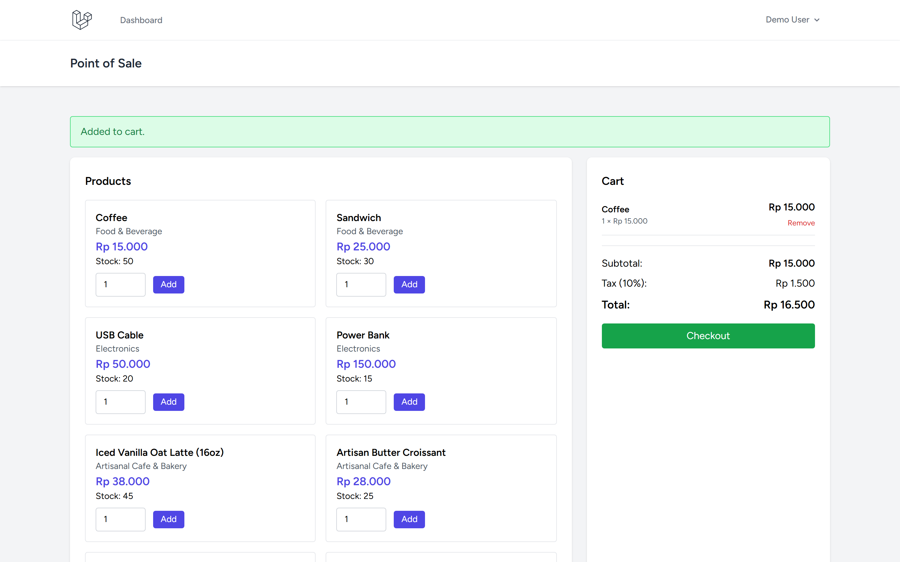
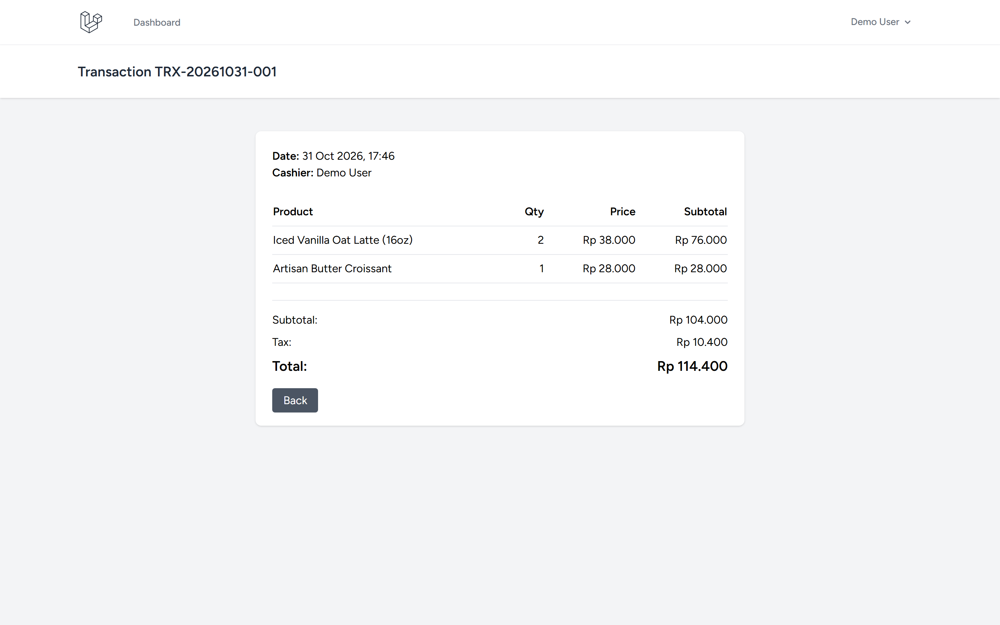
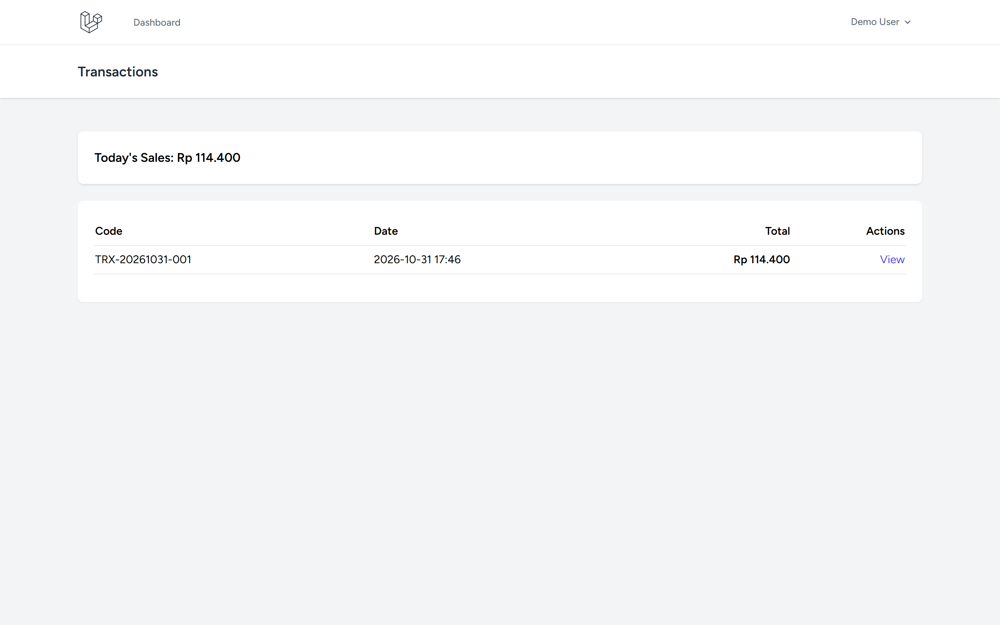
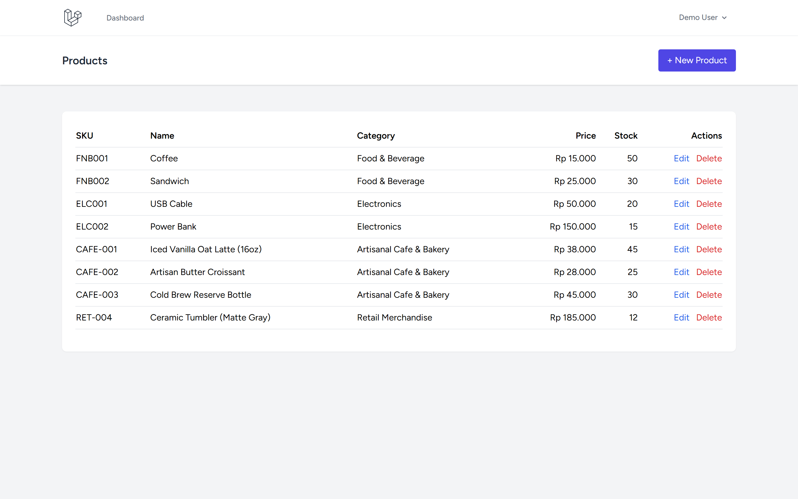

# Simple POS - Laravel

Point of Sale system with product management, cart, and transaction tracking.

Repository: https://github.com/0xyz-exe/simple-pos-laravel

## Screenshots

| Tampilan | Preview |
|---|---|
| **Terminal Kasir POS & Keranjang Belanja**<br>Antarmuka kasir penjualan langsung dengan katalog produk, input kuantitas, keranjang belanja dinamis, pajak 10%, dan tombol checkout |  |
| **Rincian Struk Transaksi Penjualan**<br>Detail struk resmi transaksi kasir dengan kode unik TRX, rincian produk yang dibeli, harga satuan, subtotal, dan total akhir |  |
| **Log Riwayat Transaksi & Ringkasan Harian**<br>Buku rekapitulasi riwayat transaksi penjualan harian kasir lengkap dengan ringkasan omzet dan tautan inspeksi struk |  |
| **Manajemen Inventaris & Katalog Produk**<br>Panel pengelolaan produk toko untuk memantau kode SKU, kategori produk, harga jual dalam Rupiah, dan kuantitas stok barang |  |

## Features

- User authentication
- Product management (CRUD, SKU, categories)
- Real-time cart
- Checkout with stock validation
- Transaction history with daily sales summary
- Database transactions for inventory safety
- Stock deduction on checkout

## Tech Stack

- Laravel 13.38.0
- PHP 8.5.0
- Breeze authentication
- SQLite
- Tailwind CSS

## Installation

```bash
git clone https://github.com/0xyz-exe/simple-pos-laravel.git
cd simple-pos-laravel
composer install
cp .env.example .env
php artisan key:generate
touch database/database.sqlite
php artisan migrate --seed
php artisan serve
```

## Demo Account

- Email: demo@example.com
- Password: password

## Database Schema

- **categories**: id, name, description
- **products**: id, category_id, name, sku, price, stock
- **transactions**: id, transaction_code, user_id, subtotal, tax, discount, total
- **transaction_items**: id, transaction_id, product_id, quantity, price, subtotal

## Features Detail

### POS Interface
Add products to cart, adjust quantities, checkout with automatic stock deduction.

### Product Management
Full CRUD, SKU validation, category assignment, stock tracking.

### Transaction History
View all transactions with date, total, and detailed items. Daily sales summary.

### Inventory Safety
Database transactions prevent overselling. Locks ensure stock accuracy during checkout.

## Security

- CSRF protection
- SQL injection prevention
- Transaction rollback on errors
- Stock validation before checkout

## Repository

https://github.com/0xyz-exe/simple-pos-laravel
